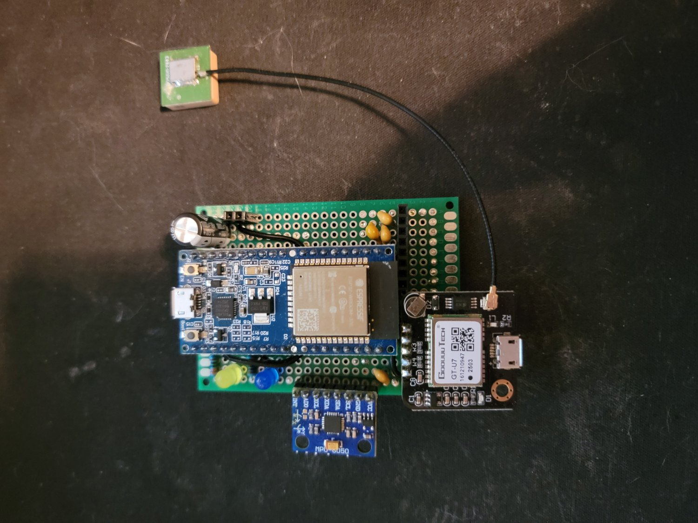
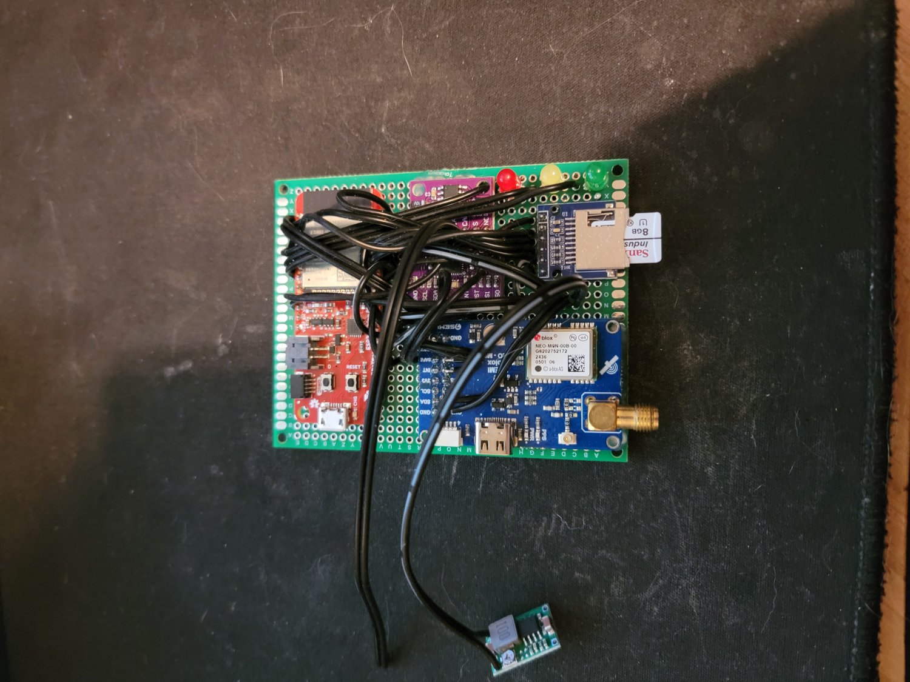

# Race Logger

An ESP32 OBD-II logger for CAN, GPS and IMU, recording to SD and publishing over MQTT, with an
Android companion app for configuration over BLE. Its ingest path grew into the robo-services
telemetry pipeline (kreceiver → iggy), which the phone gateway and the dbc-forge CAN dongle now
also feed.

Moved out of `robotics/robo-services` (`capture_device_configs/mid_tier_device/`) on 2026-11-07;
earlier history is in that repo.

## Layout

| Path | What |
|---|---|
| `firmware/v1/` | v1 sketch, wiring and photo |
| `firmware/v2/` | v2, the current build: PlatformIO project (`platformio.ini`, sources in `race_logger/`), `configure_gps.py`, photo |
| `companion_app/` | Android companion app (BLE config: Wi-Fi, MQTT) and its CHANGELOG |
| `docs/gps_setup.md` | NEO-M9N setup, 10 Hz |
| `designs/xiao_s3/` | Two XIAO ESP32-S3 designs (a pin plan and a firmware sketch), never built |

## Revisions

**v1** (`firmware/v1/`): ESP32-WROOM-32E dev board, GoouuuTech GT-U7 GPS with a patch antenna, MPU-6050
IMU, two LEDs, no CAN. GPS and IMU as JSON over Wi-Fi UDP.



**v2** (`firmware/v2/`): the build documented below. SparkFun ESP32 Thing Plus, u-blox NEO-M9N with an SMA
antenna connector, BNO08x IMU, TJA1051T, microSD module, buck regulator, three LEDs.



## Related hardware

The race logger is one of two device lines feeding robo-services (from the user, 2026-11-08):

- **Race logger:** v1, then v2 (this repo). The XIAO ESP32-S3 designs in `designs/xiao_s3/`
  were never built.
- **CAN dongle:** started as the SD CAN logger (`embedded/dbc-forge`, `firmware/sd_can_logger/`).
  The early units were XIAO ESP32-S3s; later ones moved to the XIAO ESP32-C6, which was cheaper and
  easier to get. The dbc-forge BLE bridge and the phone gateway run on that dongle hardware. The
  two XIAO S3s became a pair of SavvyCAN (ESP32RET) sniffers (robo-services
  `docs/hardware/esp32ret_xiao_s3.md`).

# v2 reference
SparkFun ESP32 Thing Plus · u-blox NEO-M9N · BNO085 · TJA1051T · SPI SD · MQTT

---

## Hardware

**Board:** SparkFun ESP32 Thing Plus (DEV-15663)

### Pin assignments

| Board Label | Side  | GPIO    | Connected To              |
|-------------|-------|---------|---------------------------|
| 17          | Right | GPIO17  | NEO-M9N RX (GPS UART TX)  |
| 16          | Right | GPIO16  | NEO-M9N TX (GPS UART RX)  |
| SDA         | Left  | GPIO23  | BNO085 SDA                |
| SCL         | Left  | GPIO22  | BNO085 SCL                |
| A0          | Right | GPIO36  | BNO085 INT (unused)       |
| 14          | Left  | GPIO14  | TJA1051T TXD (TWAI TX)    |
| 21          | Right | GPIO21* | TJA1051T RXD (TWAI RX)    |
| 13          | Left  | GPIO13  | TJA1051T S (slope control)|
| SCK         | Right | GPIO5   | SD CLK                    |
| MOSI        | Right | GPIO18  | SD MOSI                   |
| MISO        | Right | GPIO19  | SD MISO                   |
| 15          | Left  | GPIO15  | SD CS                     |
| 32          | Left  | GPIO32  | Red LED (anode)           |
| 33          | Left  | GPIO33  | Yellow LED (anode)        |
| 27          | Left  | GPIO27  | Green LED (anode)         |
| VUSB        | Left  | —       | Buck converter 5V out     |
| 3.3         | Right | —       | All peripheral VCC        |
| GND         | Right | —       | All peripheral GND        |

*Right-side pin 21 and left-side SDA confirmed independent via continuity test.

### BNO085 tie-off pins
- PS0 → GND (I2C mode)
- PS1 → GND (I2C mode)
- RST → 3.3V (no GPIO control needed)
- SA0 → GND (I2C address 0x4A)

### TJA1051T tie-off pins
- STB → GND (normal operating mode always on)
- CANH → OBD2 pin 6
- CANL → OBD2 pin 14

### Power
- OBD2 pin 16 (VBAT ~12V always-on) → buck converter in
- Buck converter out (5V) → board VUSB
- OBD2 pins 4+5 → board GND
- Board 3.3V out → all peripheral VCC pins

### Passive components
- 4.7kΩ pull-up resistor on BNO085 SDA line to 3.3V
- 4.7kΩ pull-up resistor on BNO085 SCL line to 3.3V
- 10kΩ pull-up resistor on SD CS line to 3.3V
- 100nF bypass cap on BNO085 VDD as close to pin as possible
- 220Ω series resistor on Red LED cathode to GND
- 150Ω series resistor on Yellow LED cathode to GND
- 100Ω series resistor on Green LED cathode to GND
- TVS diode + polyfuse on OBD2 VBAT input (recommended)

---

## Build

Run from `firmware/v2/`.

### First time setup
1. Install [PlatformIO](https://platformio.org/install)
2. `pio run`: libraries install automatically; mpack is already in `race_logger/`

Builds with PlatformIO 6.1.18 (verified 2026-11-08): 1.52 MB, 77% of the app partition.

The partition table is `min_spiffs.csv` (two 1.9 MB app slots for OTA, small SPIFFS). The
firmware outgrew `default.csv`'s 1.25 MB slots. A board last flashed with another table needs one
USB flash, not OTA, to switch, and that flash wipes SPIFFS, so the device config has to be
entered again. Which table the v2 board has now is ⚠ unverified.

### Upload and monitor
```bash
pio run --target upload
pio device monitor
```

### OTA upload (after first flash)
```bash
pio run --target upload --upload-port race-logger.local
```

---

## First Boot

1. Power on — **RED** LED lights (boot init)
2. Device broadcasts WiFi AP: `RaceLogger-Setup`
3. Connect phone/laptop to that AP
4. Browser opens captive portal (or navigate to `192.168.4.1`)
5. Enter WiFi SSID + password
6. Enter MQTT host, port, username, password, topic
7. Save — device reboots and connects to your network
8. **YELLOW** — waiting for GPS lock and CAN data
9. **GREEN** — GPS locked (HDOP < 3.0) and CAN frames flowing, full capture running

To re-run the config portal: erase SPIFFS with `pio run -t erase` and reflash.

---

## CAN Filter

Edit `CAN_ALLOWLIST[]` in `race_logger.ino` with the 11-bit IDs you want to keep.
Set `ALLOW_ALL_CAN true` during initial development to log everything, then use
the decode script to inventory what's on the bus before narrowing the list.

---

## SD Log Format

Binary records:
```
[MAGIC 4 bytes: 0xDEAD1234]
[LENGTH 2 bytes: little-endian payload size]
[PAYLOAD N bytes: MessagePack map]
[CRC32 4 bytes: CRC of payload only]
```

### MessagePack keys (short names to minimize payload size)

All records:
- `t`  → uint32  — millis() timestamp
- `tp` → string  — type: `"gps"`, `"imu"`, or `"can"`

GPS additions: `la` (lat), `lo` (lon), `al` (alt m), `sp` (speed m/s), `sa` (satellites)

IMU additions: `qi/qj/qk/qr` (quaternion), `ax/ay/az` (accel m/s²), `gx/gy/gz` (gyro rad/s)

CAN additions: `id` (11-bit CAN ID), `d` (raw payload bytes)

### Decode script (Python)
```python
import struct, msgpack, sys

MAGIC = 0xDEAD1234

def decode_log(path):
    with open(path, 'rb') as f:
        data = f.read()
    offset, records = 0, []
    while offset + 10 <= len(data):
        magic, = struct.unpack_from('<I', data, offset)
        if magic != MAGIC:
            offset += 1
            continue
        length, = struct.unpack_from('<H', data, offset + 4)
        if offset + 10 + length > len(data):
            break
        payload = data[offset + 6 : offset + 6 + length]
        try:
            records.append(msgpack.unpackb(payload, raw=False))
        except Exception as e:
            print(f"[WARN] unpack failed at {offset}: {e}")
        offset += 6 + length + 4
    return records

if __name__ == '__main__':
    recs = decode_log(sys.argv[1])
    for r in recs[:20]:
        print(r)
    print(f"\nTotal records: {len(recs)}")
```
`pip install msgpack`

---

## GPS — Changing from 1 Hz to 10 Hz

The sketch sends UBX-CFG-RATE on every boot (RAM only — resets on power loss).
To persist 10 Hz to the module's flash, see `docs/gps_setup.md`.
