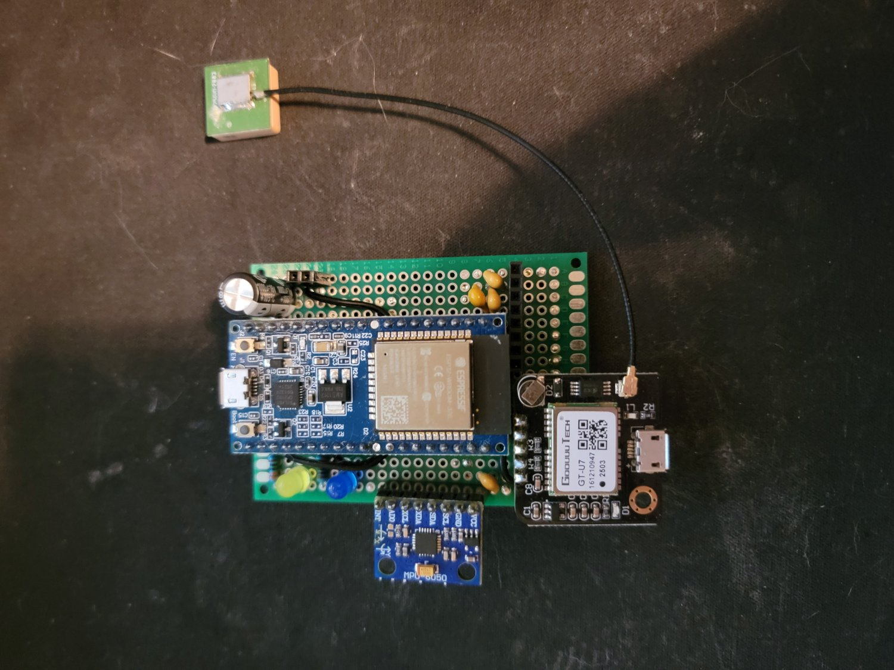

# Race logger v1

ESP32-WROOM-32E dev board, GoouuuTech GT-U7 GPS (patch antenna), MPU-6050 IMU, two status LEDs.
No CAN. Superseded by v2 (`../v2/`).

The sketch reads GPS on UART2 (GPIO16/17, 9600 baud) and the MPU-6050 on I2C (GPIO21/22), and
sends JSON over Wi-Fi UDP (port 5514) to kreceiver's UDP listener, which robo-services has since
removed. LEDs: Wi-Fi on GPIO32, GPS fix on GPIO26 (fast blink while searching, heartbeat once
acquired). Last changed 2026-05-26.

| File | What |
|---|---|
| `esp32_gps_udp_feed/` | The sketch. Set `kWifiSsid`, `kWifiPassword` and `kReceiverIp` before flashing |
| `wiring.txt` | Wiring. It also lists an SSD1306 OLED on the I2C bus, which the sketch doesn't use |
| `udp_receiver_example.py` | Prints the UDP packets, for bench testing without kreceiver |

Libraries: Adafruit MPU6050, Adafruit Unified Sensor, TinyGPSPlus. Not compiled since the restore (Adafruit MPU6050 is not installed in this machine's arduino-cli).

Restored from robo-services `capture_device_configs/gps-test-feed/` (removed there in 6950073).
