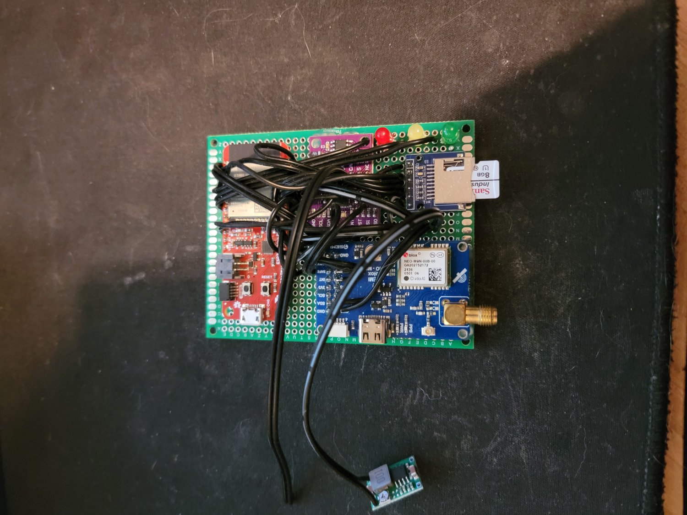

# Race logger v2

SparkFun ESP32 Thing Plus, u-blox NEO-M9N (SMA antenna), BNO08x IMU, TJA1051T CAN transceiver,
microSD, buck regulator, three LEDs. The current build; wiring and build steps are in the
top-level README.
